# 03 · User Flows

How each person moves through Mitra. Diagrams use Mermaid (renders on GitHub, VS Code, Notion).
Rule for every flow: **one primary action per screen, a sensible default for every choice, and a way back.**

---

## 1. Visitor → trial (landing page)

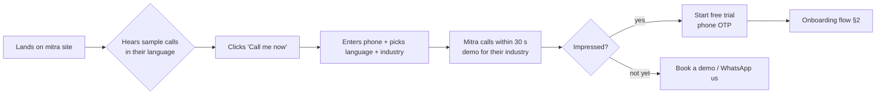

**Key moment:** the live demo call is the product's best salesperson. It must work flawlessly, in Telugu, Hindi, and English.

## 2. Owner onboarding (Phase 1) — target ≤ 10 minutes

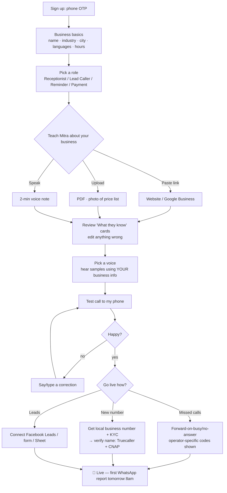

Screen-level detail in [07-SCREENS.md](07-SCREENS.md) §3.

**Edge cases**
- No website → skip to photo/voice note; industry starter pack fills common FAQs.
- Test call not answered → retry button + "Call my other number".
- KYC pending for new number → allow go-live via call forwarding meanwhile.
- Owner abandons mid-way → WhatsApp nudge after 2 h with deep link to the exact step.

## 3. A day with Mitra — owner on WhatsApp

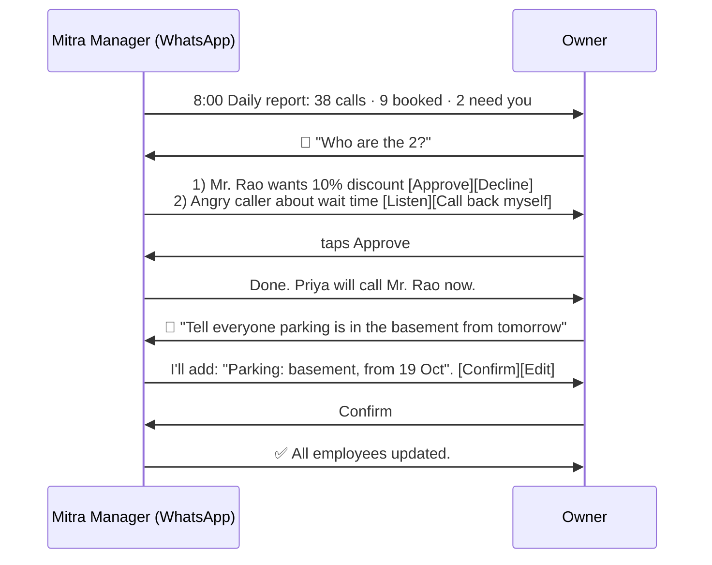

## 4. Inbound call (caller's experience)

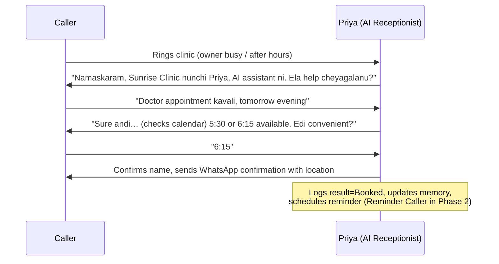

Escape hatches at any point: caller says "talk to a person" → warm transfer (or message if no one free); caller says "don't call me" → suppressed.

## 5. Lead calling (real estate)

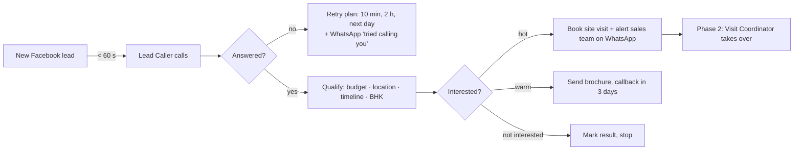

## 6. Correcting a mistake (trust loop)

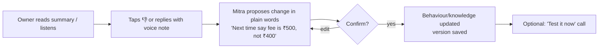

## 7. Building an AI team (Phase 2)

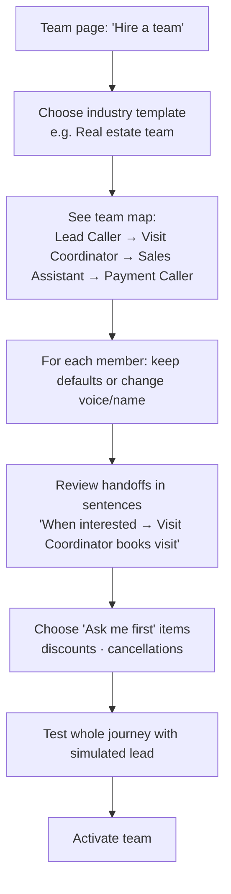

## 8. Creating a routine (Phase 2)

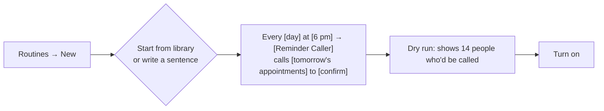
Also creatable by WhatsApp: *"Every evening call tomorrow's patients to confirm"* → Manager drafts routine → owner confirms.

## 9. Staff member (front-desk) flow

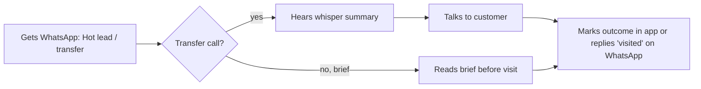

## 10. Agency flow (Phase 3)

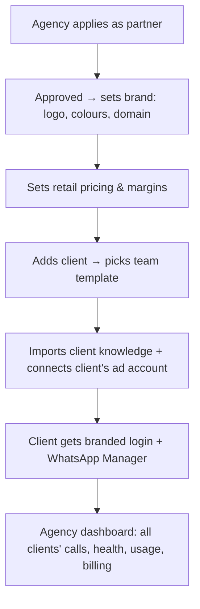

## 11. Billing & low balance

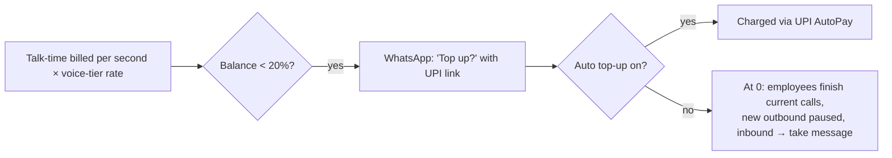
Inbound calls must **never** silently fail — at zero balance, Mitra still takes a short message (grace minutes).

## 12. Data deletion request (customer of the business)

Caller: "Delete my data" → employee confirms → request logged → owner notified → erasure job within SLA → confirmation WhatsApp to caller. See [08](08-COMPLIANCE-SECURITY.md).
