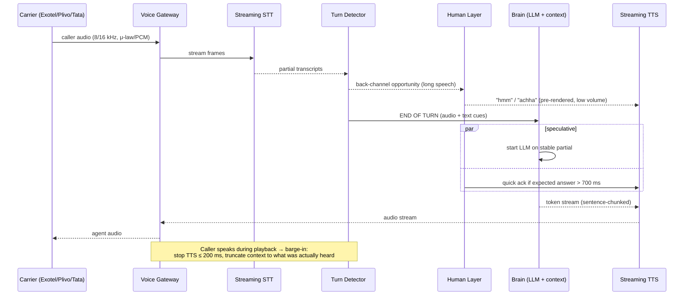
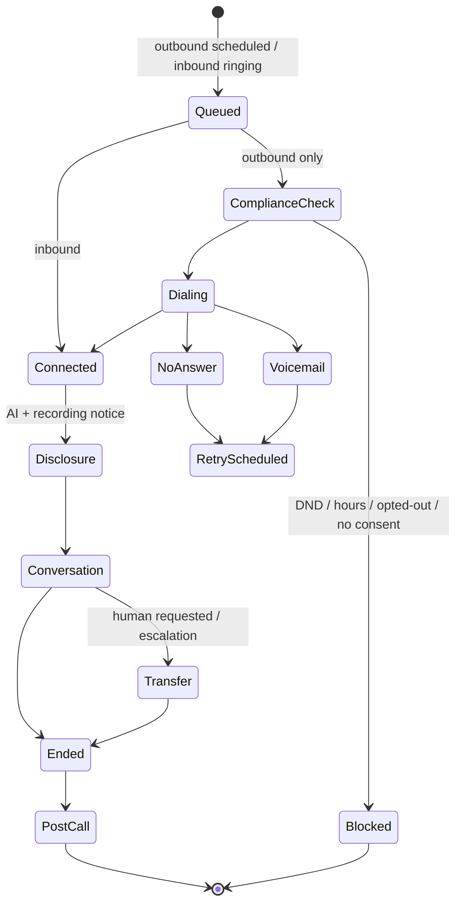
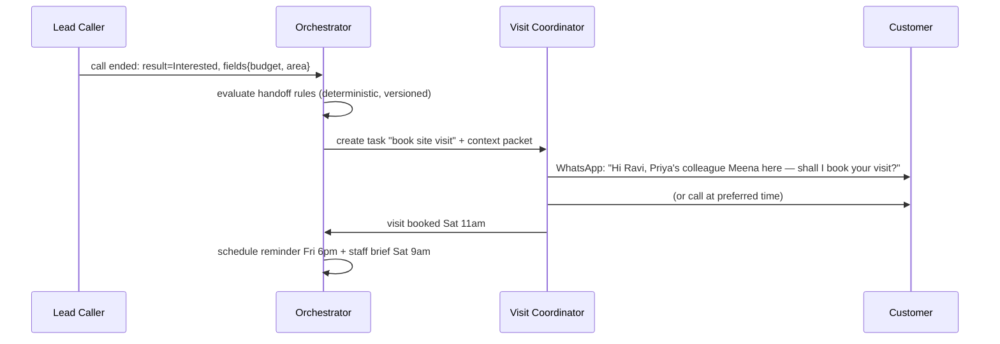
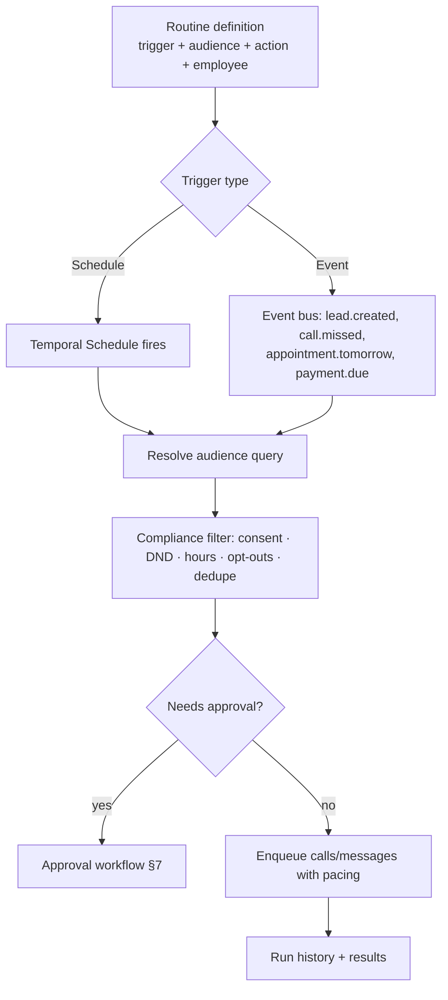
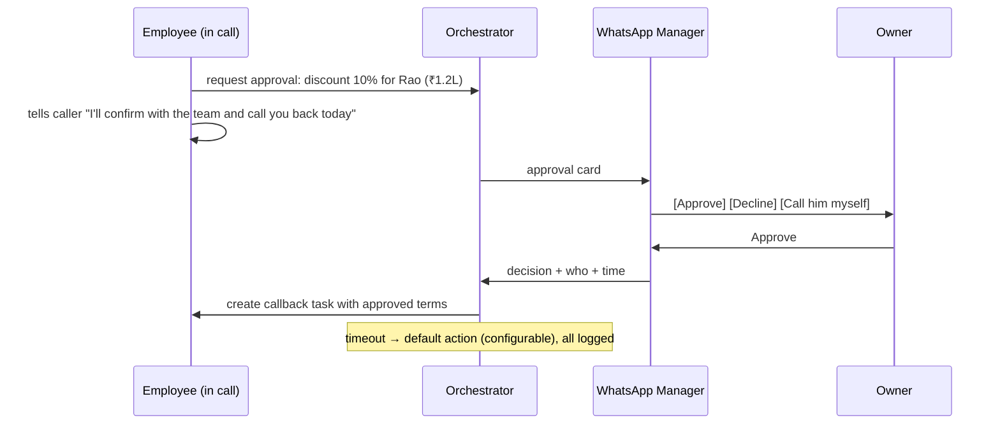
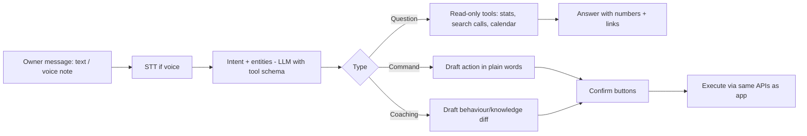
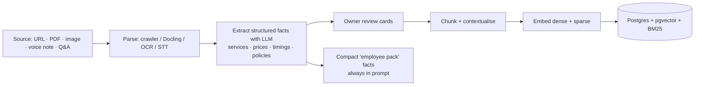

# 04 · System Workflows

What happens behind the scenes. Components referenced here are defined in [05-TRD.md](05-TRD.md).

---

## 1. Real-time call loop (one conversational turn)



### Latency budget (target p50 / p95)

| Stage | p50 | p95 |
|---|---|---|
| Carrier + network in | 60 ms | 100 ms |
| Turn detection decision | 150 ms | 250 ms |
| LLM time-to-first-token (context cached) | 200 ms | 350 ms |
| TTS time-to-first-byte | 90 ms | 150 ms |
| Network out | 50 ms | 80 ms |
| **Total to first audio** | **~550 ms** | **~800 ms** |

Rules: everything streams; no blocking DB call in the hot path; knowledge and customer memory are **pre-loaded at call start**; retrieval only if needed and in parallel.

## 2. Call lifecycle



## 3. Call start — context assembly (< 150 ms, before greeting)

1. Resolve **business** from dialled number / campaign.
2. Resolve **employee** (routing rules: hours, branch, language, team stage).
3. Look up **caller** by phone (hashed index) → customer memory + last 5 interaction summaries.
4. Load **employee pack** from cache: behaviour, knowledge snapshot (compact), tools, voice config, compliance flags.
5. Choose **greeting** variant: new vs returning caller, language guess (caller's last language → business default).
6. Open STT/TTS streams (pre-warmed pool).

## 4. Post-call pipeline (async, Temporal workflow)

```mermaid
flowchart LR
  E[Call ended event] --> R[Store recording → S3 Mumbai]
  E --> T[Final transcript - higher-accuracy batch STT]
  T --> S[Summarise · result · fields · sentiment<br/>(larger LLM)]
  S --> M[Update customer memory<br/>confirmed vs inferred]
  S --> A[Run actions: Sheet row · CRM · WhatsApp]
  S --> H{Handoff rule matches?}
  H -- yes --> N[Create task for next employee]
  S --> U{Unknown questions?}
  U -- yes --> I[Add to owner's unknown-question inbox]
  S --> Q[Quality scoring: latency, interruptions,<br/>hallucination check vs knowledge]
  S --> B[Usage ledger: billable seconds]
  S --> W[Alerts: hot lead / angry / VIP → WhatsApp]
```

## 5. Team handoff (Phase 2)



Design choice: **handoffs happen between interactions, never multiple LLM agents talking inside one live call.** One live call = one employee = lowest latency. The orchestrator is a deterministic rule engine + durable workflows, with an LLM only for summarising and drafting.

**Context packet** passed on handoff: customer id, summary, collected fields, open questions, promises made ("will send brochure"), language & formality preference, do-not-do notes.

## 6. Routines (autopilot)



Sentence-builder routines compile to a typed JSON spec (see TRD §9) — owners never see the JSON.

## 7. Approvals ("Ask me first")



## 8. WhatsApp AI Manager — command handling



Safety: read actions auto-run; any write (calls, behaviour change, list calls, pause) needs a confirm tap. Permissions follow the sender's role.

## 9. Knowledge ingestion



Two layers (see TRD §7): **Facts pack** (always in context, cached) + **Deep retrieval** (only for large catalogs/docs).

## 10. Lead intake

`Meta Lead Ads webhook / form / Sheet poll / Zapier` → normalise phone (E.164) → dedupe (same number within 7 days merges) → consent record (source = ad form + timestamp + form text) → `lead.created` event → Lead Caller routine (call within 60 s if within allowed hours, else first allowed minute).

## 11. Billing & metering

- No subscription. Billable unit = **connected talk-time per second** (min 10 s per connected call) × the employee's **voice-tier rate** (Smart ₹3 · Natural ₹4.5 · Signature ₹6 per min). Unanswered/busy/blocked = ₹0.
- Ledger is append-only (`usage_events`) → near-real-time wallet decrement (bonus credits consumed after paid credits).
- Pass-through charges (number rental unless waived, WhatsApp template fees, verification) posted as separate ledger lines.
- Monthly spend cap: when reached, outbound pauses; inbound continues.
- Wallet thresholds fire `billing.low_balance` → WhatsApp alert + optional UPI AutoPay top-up.
- Zero balance: outbound paused; inbound gets 3 grace minutes/day to take messages.

## 11b. Outbound caller-ID selection (per call)

`purpose` (callback · service · mandated-service · promotional) + `business numbers` → choose caller ID per [08 §8](08-COMPLIANCE-SECURITY.md): callback → number the customer called; service → verified local business number; mandated sector → 1600/1601; promotional → 140 (only if enabled) else **block**. Optional WhatsApp heads-up sent 1–2 min before dialling. After each attempt, update the number's answer rate; if the 7-day answer rate drops sharply or a spam label is detected → pause that number's outbound, alert owner, start remediation.

## 12. Incident & fallback workflow

| Failure | Automatic fallback |
|---|---|
| STT provider error/timeout | Switch to secondary STT within same call |
| TTS provider error | Secondary TTS voice closest in timbre; log incident |
| LLM timeout > 1.5 s | Graceful filler + retry on fallback model; if repeated, apologise and offer callback/transfer |
| Carrier outage | Route outbound via secondary carrier; inbound via forwarding fallback |
| Calendar/CRM down | Take details, promise confirmation, retry action in background |
| Total platform degradation | Status page + WhatsApp alert to owners; inbound forwards to owner's phone |
