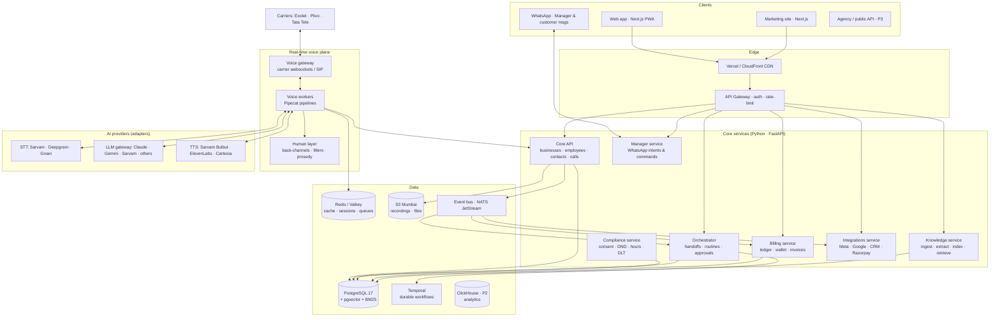

# 05 · TRD — Technical Requirements Document

Version 1.0 (draft). Choices marked **[Decide in Spike]** need a 1–2 week bake-off on real Telugu/Hindi phone audio before locking.

---

## 1. Architecture principles

1. **Latency is a feature.** Everything in the call path streams; nothing blocks.
2. **Provider-agnostic voice stack.** STT, LLM, TTS, carrier are swappable adapters — quality and prices change monthly.
3. **One live call = one employee.** Multi-agent coordination happens *between* interactions via durable workflows.
4. **Deterministic where it matters.** Compliance, handoff rules, billing, approvals = code + rules, not LLM judgement.
5. **India-resident data.** All customer data and recordings stored in Indian regions.
6. **Same API for app, WhatsApp Manager, agencies.** No hidden back doors; the Manager is just another client.
7. **Multi-tenant from day one** (business → branch; agency → clients).

## 2. High-level architecture



## 3. Technology stack ("best for the job", Oct 2026)

| Layer | Choice | Why | Alternatives |
|---|---|---|---|
| Web app & marketing | **Next.js (App Router, latest stable) + React + TypeScript** | SSR/SEO for marketing, RSC for fast dashboards, huge ecosystem | Remix, Astro (marketing only) |
| Styling | **Tailwind CSS v4** + CSS variables tokens | Speed, consistency with shadcn/21st.dev ecosystem | — |
| Components | **shadcn/ui + Radix primitives**; curated blocks from **21st.dev, Magic UI, Aceternity UI, React Bits, Origin UI, Motion Primitives, Tailark** | Copy-in source we own; accessible primitives | — (see Design System §9) |
| Animation | **Motion** (formerly Framer Motion), Lottie for illustrations | Industry standard, reduced-motion support | GSAP for marketing hero only |
| Data fetching / state | TanStack Query, Zustand (local UI state), nuqs (URL state) | Simple, cache-aware | — |
| Forms & validation | react-hook-form + **Zod** (shared schemas) | Typed validation at boundary | — |
| Charts | Recharts via shadcn charts / Tremor | Clean, themeable | — |
| i18n (UI) | next-intl (English, Telugu, Hindi) | Mature | — |
| Auth | **Better Auth** (self-hosted) — phone OTP, Google; JWT verified by services | Data stays in India, no per-MAU fees | Supabase Auth |
| Core backend | **Python 3.13 + FastAPI + Pydantic v2 + SQLAlchemy 2 / SQLModel** | Same language as voice/AI stack; async; typed | NestJS (TS) |
| Voice orchestration | **Pipecat** (primary) **[Decide in Spike vs LiveKit Agents]** | Native Exotel/Plivo serializers, 60+ TTS / 58+ STT adapters, open-source Smart Turn | LiveKit Agents (native SIP, strong turn detector, test framework) |
| Turn detection | Pipecat Smart Turn (open weights) + Silero VAD; fine-tune on Telugu/Hindi call audio | Audio-native end-of-turn | LiveKit turn detector |
| STT (streaming) | **Sarvam (Saarika/Saaras)** primary for Indic; Deepgram fallback; Gnani for some dialects **[Spike]** | Indic accuracy, code-mixing | ElevenLabs Scribe, AI4Bharat IndicConformer (self-host, P3) |
| TTS (streaming) | **Sarvam Bulbul v3** primary for Indic & code-mix; ElevenLabs Flash for English-heavy; Cartesia fallback **[Spike]** | Bulbul led blind naturalness tests across 11 Indian languages | Smallest.ai, Indic Parler-TTS (self-host) |
| LLM — live turns | Fastest model passing our Indic eval (candidates: Claude Haiku-class, Gemini Flash-class, Sarvam models, GPT mini-class) **[Spike]** | TTFT < 350 ms p95 with cached prefix | — |
| LLM — background | Claude Sonnet-class (summaries, extraction, Manager, coaching diffs); Opus-class for offline evals | Quality, tool use, long context | — |
| LLM gateway | **LiteLLM** (self-hosted) — routing, fallbacks, budgets, logging | Provider-agnostic | Portkey |
| Speech-to-speech | Evaluate realtime S2S models quarterly against IndicFDB; adopt when they beat the cascade on Indic | Future lower latency | — |
| Durable workflows | **Temporal** (self-host or Temporal Cloud) | Routines, retries, approvals waiting days, handoffs — exactly-once semantics | Inngest, Restate |
| Event bus | NATS JetStream | Lightweight, persistent streams | Kafka (at scale) |
| Primary DB | **PostgreSQL 17** (AWS RDS/Aurora Mumbai) + **pgvector + pgvectorscale** + **BM25 via ParadeDB pg_search** | One DB for app + vectors + full-text, RLS for tenancy | Qdrant if retrieval outgrows Postgres |
| Cache/queues | Valkey (Redis-compatible) | Session state, rate limits, hot config | — |
| Object storage | S3 ap-south-1 (Mumbai) + ap-south-2 (Hyderabad) replication | India residency | — |
| Analytics | PostHog (product analytics, flags — self-host/EU); ClickHouse for call analytics (P2) | — | — |
| Document parsing | **Docling** (PDF/DOCX/XLSX), vision LLM for photos & Indic OCR, Sarvam document parsing **[Spike]**, Firecrawl / Crawl4AI for websites | Robust layout + tables | Unstructured |
| Observability | OpenTelemetry → Grafana (Tempo/Loki/Prometheus), Sentry, **Langfuse** (LLM traces & evals) | Per-turn latency tracing | Datadog |
| Infra | AWS Mumbai + Hyderabad; **ECS Fargate** (P1) → EKS (P2+); Terraform; GitHub Actions | Simple → scalable | GCP Mumbai |
| Payments | **Razorpay** (UPI AutoPay, subscriptions, GST invoices); Stripe for foreign agencies (P3) | India-native | Cashfree |
| WhatsApp | Meta WhatsApp Cloud API via BSP (Gupshup / Interakt / AiSensy) **[Decide]**; WhatsApp Business Calling (P2) | Templates, interactive buttons | — |
| Telephony | **Exotel** (primary, India local numbers, Voicebot streaming, Truecaller verified caller ID), **Plivo** (secondary), Tata Tele Business (SIP trunks for bring-your-own landline/PRI, 1600/1601 and 140 where needed) | Multi-carrier resilience; caller-ID strategy per [08 §8](08-COMPLIANCE-SECURITY.md) | Knowlarity, Ozonetel |

## 4. Services & responsibilities

| Service | Owns | Key APIs/events |
|---|---|---|
| Core API | businesses, branches, users, roles, employees, contacts, calls, results | REST `/v1/*`, emits `call.*`, `contact.*` |
| Voice gateway | carrier sessions, media bridging, recording tap, DTMF | WS/SIP; emits `call.started/ended` |
| Voice workers | per-call pipeline: VAD → STT → turn → LLM → TTS; tools invocation | gRPC to Core for tools; Redis for live state |
| Human layer | back-channel/filler policy, prosody hints, number/date normalisation | in-process library inside workers |
| Knowledge | ingestion, extraction, facts pack, hybrid retrieval | `/v1/knowledge/*`, `knowledge.updated` |
| Orchestrator | handoffs, routines, approvals, campaigns | Temporal workflows; consumes events |
| Manager | WhatsApp inbound, intents, confirmations, reports | BSP webhooks; calls Core/Orchestrator |
| Compliance | consent ledger, DND/NCPR checks, calling windows, opt-outs, DLT templates, disclosures | sync check API (< 20 ms cached) |
| Billing | per-second usage ledger, wallets, voice-tier rates, top-up bonuses, spend caps, pass-through charges, invoices, agency wholesale | `usage.*`, Razorpay webhooks |
| Numbers | number inventory, KYC, caller-ID selection per call purpose, Truecaller/CNAP registration status, answer-rate & spam-label health | `number.health_changed` |
| Integrations | OAuth tokens (encrypted), connectors, sync jobs | per-connector workers |

## 5. Voice pipeline detail

**Audio:** carrier 8 kHz μ-law (PSTN) or 16 kHz (WhatsApp/web) → resample to STT native rate; TTS output at carrier rate; jitter buffer ≤ 60 ms.

**Turn-taking:**
- Silero VAD for speech presence; Smart-Turn-style audio model for end-of-turn; text cues from partial STT (incomplete clause, "umm", "and…").
- Adaptive patience: longer wait after questions requiring thought (dates, numbers), shorter after yes/no.

**Speculative generation:** start LLM on stable partial transcript; discard if final transcript differs materially.

**Barge-in:** VAD-triggered TTS stop ≤ 200 ms; context truncated to the words actually played (word timestamps from TTS) so the AI knows what the caller heard.

**Human layer (our moat, in-house):**
| Behaviour | Implementation |
|---|---|
| Back-channels | Policy model over VAD/partials (speech > 4 s, falling pitch at clause end) → play pre-rendered clips in the same voice, -6 dB, per language/dialect |
| Instant acknowledgements | If predicted answer latency > 700 ms (tool call, retrieval) → short filler ("ok, ek second…") |
| Fillers & disfluency | LLM style guide + light SSML/prosody controls; never more than 1 filler per turn |
| Code-mix | LLM outputs natural mixed text in Roman/native script per TTS needs; transliteration normaliser |
| Indian normalisation | Rule library: ₹ amounts (lakh/crore/thousand), dates, times, phone digits grouping, addresses, ordinals — per language |
| Formality | Business setting + caller cues → pronoun/honorific selection |
| Ambience | Optional mixed background bed at -30 dB |

**Prompt structure (cached prefix → minimal per-turn tokens):**
1. Global safety & compliance rules (static, cached)
2. Role template + industry pack (cached per employee version)
3. Facts pack — business knowledge (cached per knowledge version)
4. Customer memory card (per call)
5. Running conversation (rolling, summarised after N turns)

**Tools available in-call (Phase 1):** `check_availability`, `book_slot`, `reschedule`, `cancel`, `send_whatsapp_template`, `transfer_to_human`, `schedule_callback`, `lookup_fact` (deep retrieval), `record_field`, `request_approval` (P2), `end_call`.

## 6. LLM strategy

- **Routing:** live turns → fast tier; tool-heavy or long reasoning turn → escalate to mid-tier with filler masking; background → mid-tier; evals → top tier.
- **Prompt caching** on static prefix (sections 1–3) to cut TTFT and cost.
- **Structured outputs** (JSON schema) for summaries, results, field extraction, Manager intents.
- **Guardrails:** output checker for price/number claims vs facts pack (post-turn, async flag; pre-speech for high-risk categories like prices & medical); healthcare refusal patterns.
- **Evals (Langfuse + in-house):** golden conversation sets per industry × language; LLM-as-judge + human panel weekly; regression gate on every prompt/model change.

## 7. RAG & knowledge — "best RAG" for voice

Small-business knowledge is usually small (services, prices, timings, FAQs ≈ 5–30k tokens). The best answer for latency **and** accuracy is a two-layer design:

**Layer A — Facts pack (default path, zero retrieval latency)**
- LLM extracts structured facts from all sources → owner-reviewed cards → compiled into a compact, deduplicated facts pack (target ≤ 8k tokens) placed in the **cached** prompt prefix.
- Covers > 90% of SMB questions with no retrieval call.

**Layer B — Deep retrieval (large catalogs: property inventory, 500-item price lists, long policy PDFs)**
- **Ingestion:** Docling / crawler / OCR → semantic chunking (300–500 tokens, overlap 15%) → **contextual chunk headers** (LLM-written 1–2 line context prepended per chunk) → store.
- **Indexes:** dense embeddings (**BGE-M3** multilingual, self-hosted on GPU/CPU; or Cohere multilingual embed via API **[Spike]**) + **BM25** (ParadeDB pg_search) + metadata filters (business_id, branch, type, validity dates).
- **Query:** hybrid search (dense top-50 + BM25 top-50) → **Reciprocal Rank Fusion** → **cross-encoder rerank** (bge-reranker-v2-m3 self-hosted or Cohere Rerank) → top 3–5 chunks.
- **Voice latency tactics:** (1) **speculative retrieval** on partial transcripts, (2) **semantic cache** keyed by normalised question per business, (3) pre-fetch per call based on caller's history (e.g. last enquired project), (4) filler masking if retrieval > 300 ms.
- **Structured data beats RAG:** live inventory/schedules come from Sheets/CRM via typed tools, not embeddings.
- **Multilingual:** queries may be Telugu/Hindi/code-mixed; store chunks in source language + English normalised field; BGE-M3 handles cross-lingual; evaluate with IndicRAGSuite-style test sets.
- **Freshness:** facts have `valid_from/valid_to`; knowledge versioned; employee pack rebuilt on change (< 60 s).
- **Upgrade path:** move vectors to Qdrant if > 50M chunks or heavy filtering; add graph memory only if evals prove benefit.

## 8. Memory design

| Memory | Storage | Written by | Read |
|---|---|---|---|
| Customer profile (name, language, preferences) | `contacts` + `contact_attributes` | post-call extractor, owner edits | call start |
| Facts about customer (needs, budget, concerns) | `memory_facts` (`status: confirmed / inferred`, source call id, confidence, expiry) | post-call extractor | call start (top-k by recency & relevance) |
| Episodic summaries | `interaction_summaries` (≤ 80 words each) | post-call | last 5 at call start |
| Promises & open loops | `commitments` (due date, owner employee) | in-call tool + post-call | orchestrator + call start |

Rules: inferred facts never stated to customer as certainties; owner can edit/delete; erasure cascades.

## 9. Orchestrator: teams, routines, approvals

- **Handoff rule (typed):** `{ when: {result: "interested", fields: {budget: ">=50L"}}, then: {employee: "visit_coordinator", action: "book_visit", channel: "whatsapp_then_call", delay: "PT10M"} }`
- **Routine spec:** `{ trigger: {type: "schedule", cron: "0 18 * * *", tz: "Asia/Kolkata"} | {type: "event", name: "lead.created", filter: {...}}, audience: {query}, action: {employee, task, channel}, approval: {required: bool}, pacing: {max_concurrent, window} }`
- Each routine run = Temporal workflow; each contact = child workflow (dedupe, compliance check, attempt, retries, result).
- Approvals = workflow waiting on signal with timeout + default.

## 10. Data model (core entities)

```
agency 1─* business 1─* branch
business 1─* user_membership *─1 user (role: owner|manager|staff|agency_admin)
business 1─* employee (role_template, voice_profile_id, behaviour_version_id, status)
employee 1─* behaviour_version (json spec, created_by, created_at)
business 1─* team 1─* team_member(employee) ; team 1─* handoff_rule
business 1─* knowledge_source 1─* knowledge_chunk (embedding, bm25, context_header)
business 1─* fact (category, key, value, source_id, valid_from/to, version)
business 1─* contact (phone_e164_hash, phone_enc, name, language) 1─* memory_fact / interaction_summary / commitment
contact 1─* consent_record (purpose, source, captured_at, text, revoked_at)
business 1─* phone_number (carrier, type: local|mobile_virtual|byo_sip|1600|1601|140, kyc_status, truecaller_status, cnap_status, answer_rate_7d, spam_flag)
employee.voice_tier (smart|natural|signature) → rate_card (tier, ₹/min, effective_from)
wallet (balance, bonus_balance, monthly_cap, autopay) 1─* wallet_txn
call (business, employee, contact, direction, status, started/ended, recording_uri, transcript_uri, result, fields jsonb, latency_stats jsonb, cost)
routine 1─* routine_run 1─* task
approval (subject, requested_by_employee, decided_by_user, decision, decided_at)
integration (provider, scopes, token_enc)
usage_event (append-only) → wallet, invoice
audit_log (actor, action, entity, before/after, at)
```
Tenancy: every table carries `business_id` (and `agency_id` where relevant); **Postgres Row-Level Security** enforced via session variable set per request.

## 11. API design

- REST + JSON, versioned `/v1`, OpenAPI 3.1 generated from FastAPI; typed TS client generated for the web app.
- Idempotency keys on all POSTs that create calls/messages/payments.
- Webhooks out (P3): `call.ended`, `lead.qualified`, `appointment.booked`, `approval.decided` — HMAC-signed, retried with backoff.
- Rate limits per business & per API key; agency keys scoped to clients.

## 12. Non-functional requirements

| Category | Requirement |
|---|---|
| Latency | First audio ≤ 800 ms p95; barge-in stop ≤ 200 ms; dashboard TTI ≤ 2 s on 4G mid-range Android |
| Availability | Voice plane 99.9% monthly; core API 99.9%; graceful degradation per [04 §12](04-WORKFLOWS.md) |
| Scale (P1→P2) | 200 → 5,000 concurrent calls; 10k → 500k calls/day |
| Durability | Recordings 11-nines (S3); RPO ≤ 5 min, RTO ≤ 1 h |
| Security | See [08](08-COMPLIANCE-SECURITY.md): encryption at rest/in transit, RLS, secrets in AWS Secrets Manager, SOC 2-style controls by P3 |
| Accessibility | WCAG 2.2 AA for web app |
| Localisation | UI in EN/TE/HI at P1; all dates/currency Indian format |
| Cost | Blended COGS ≤ ₹2.5/min target by P2 |

## 13. Testing & quality

- **Unit/integration:** pytest, Vitest, Playwright (web E2E).
- **Voice simulation:** synthetic callers (LLM + TTS personas: impatient, elderly, noisy street, code-mixing) running nightly against every employee template; metrics: task success, latency, interruptions, hallucinations.
- **Benchmarks:** IndicFDB-style turn-taking tests; per-language WER on our call audio; blind human-likeness panels monthly.
- **Load:** k6 + SIP load generators for concurrency targets before each phase launch.
- **Release:** feature flags, canary by business cohort, instant rollback of behaviour/prompt versions.

## 14. Environments & DevOps

- `local` (docker compose: Postgres, Valkey, Temporal, NATS, mock carrier) → `dev` → `staging` (real carriers, test numbers) → `prod` (Mumbai primary, Hyderabad DR).
- IaC: Terraform; CI/CD: GitHub Actions (lint, type-check, tests, eval gate, build, deploy).
- Monorepo (Turborepo + uv): `apps/web`, `apps/marketing`, `services/core`, `services/voice`, `services/orchestrator`, `packages/ui`, `packages/schemas`, `infra/`.

## 15. Architecture Decision Records (initial)

| ADR | Decision | Status |
|---|---|---|
| ADR-001 | Cascaded STT→LLM→TTS with in-house human layer (not S2S) for P1 | Accepted; review quarterly |
| ADR-002 | Pipecat as voice framework | **Proposed — confirm after spike vs LiveKit Agents** |
| ADR-003 | One live call = one employee; teams via Temporal workflows | Accepted |
| ADR-004 | Postgres + pgvector + BM25 for app & retrieval; Qdrant later if needed | Accepted |
| ADR-005 | Facts pack in cached prompt + deep retrieval only when needed | Accepted |
| ADR-006 | Python backend services + TypeScript frontend | Accepted |
| ADR-007 | India data residency (AWS Mumbai/Hyderabad) | Accepted |
| ADR-008 | Deterministic compliance service gates every outbound attempt | Accepted |
| ADR-009 | WhatsApp Manager uses the same public API as the app | Accepted |

## 16. Spike plan (first 2–3 weeks of engineering)

1. **Voice bake-off:** Pipecat vs LiveKit Agents × Exotel/Plivo × {Sarvam, Deepgram} STT × {Bulbul v3, ElevenLabs, Cartesia} TTS × 3–4 fast LLMs. Measure p50/p95 latency, Telugu/Hindi WER, naturalness (10 listeners), cost/min.
2. **Turn-taking:** Smart Turn vs LiveKit turn detector on 200 real Telugu/Hindi phone turns.
3. **Facts pack:** extraction quality from 10 real clinic/real-estate websites & brochures.
4. **WhatsApp BSP:** template approval time, interactive buttons, voice-note handling, cost.
5. **Output:** finalise ADR-002 + provider defaults; publish cost/min model.
