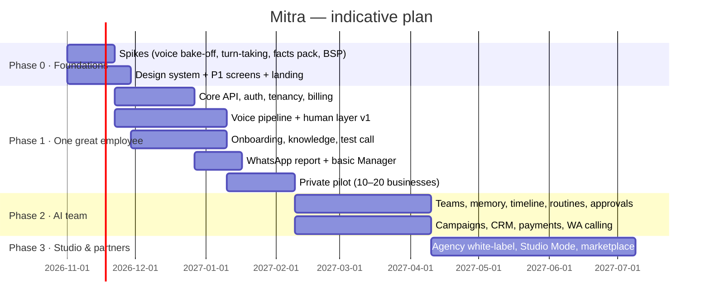

# 09 · Roadmap, Pricing & Metrics

Timelines assume a focused founding team of 3–5 with AI-assisted development; adjust once team & budget are confirmed.

---

## 1. Roadmap

### Phase gates (move forward only when met)

| Gate | Criteria |
|---|---|
| **P0 → P1 build** | Spike results: p95 first-audio ≤ 900 ms on Telugu & Hindi phone calls; naturalness ≥ 3.8/5 panel score; cost ≤ ₹3/min |
| **P1 → Public launch** | 15+ pilot businesses live ≥ 3 weeks; setup median ≤ 15 min; ≥ 70% human-likeness; no compliance incidents; NPS ≥ 40 |
| **P2 → Agencies (P3)** | ≥ 150 paying businesses; month-3 retention ≥ 75%; 5 agencies on waitlist with ≥ 10 clients each |

### Build waves (engineering)

| Wave | Scope | Status |
|---|---|---|
| A | Calls & customer memory, wallet billing, telephony & compliance gate, site sub-pages | Done (2 Nov 2026) |
| B | Dialer & campaigns, lead intake & webhooks, WhatsApp manager & approvals, AI team, routines, escalation, listen & whisper | In progress |
| C | Missed-call number (CALL-20); UPI collections with auto-matching (ACT-05, ACT-11) | Queued |

## 2. Go-to-market

1. **Founder-led pilots** — 20 clinics & builders in Hyderabad/Vijayawada; set up for them, learn daily, record case studies (with consent).
2. **Live demo as acquisition** — "Call me now" on site + WhatsApp ads targeting clinic owners/builders in Telugu.
3. **Industry content** — short videos: "Our AI receptionist answering in Telugu" (real calls with permission).
4. **Partnerships** — clinic software vendors, real-estate CRMs, digital marketing agencies (early partner programme before full white-label).
5. **Referral** — 1 month free minutes per referred business.

## 3. Pricing (indicative — validate in pilots)

### 3.1 Model: pay-per-minute, no monthly fee

Owners understand "₹4.5 a minute" instantly and compare it with a telecaller's salary. A monthly plan feels expensive and risky, so **there is no subscription.** Customers top up a wallet and pay only for connected talk-time.

| Voice tier | ₹ / connected minute (excl. GST) | What changes | Default for |
|---|---|---|---|
| **Smart** | **₹3.0** | Good natural voices on an efficient stack; basic back-channels | Reminders, confirmations, payment nudges, high-volume lists |
| **Natural** ⭐ | **₹4.5** | Premium Indic voices + full human layer (back-channels, fillers, dialect & formality tuning) | Receptionist, lead calling — **trial runs on this tier** |
| **Signature** | **₹6.0** | Top-tier voices, "sounds like my best caller" style training, consented voice clone (P3), priority capacity at peak | Premium brands, high-value real estate |

The owner can set the tier **per employee** (e.g. Receptionist on Natural, Reminder Caller on Smart). The app shows a live "this month so far: ₹X" estimate.

### 3.2 Billing rules
- Billed **per second** of connected talk-time (minimum 10 s per connected call). Unanswered, busy, voicemail-detected-and-dropped, and compliance-blocked calls are **free**.
- **Every feature at every tier**: teams, routines, approvals, WhatsApp Manager, integrations, reports. No feature paywalls.
- **Wallet:** min top-up ₹500 via UPI/card/net-banking; UPI AutoPay top-up optional. Credits valid 12 months.
- **Top-up bonus:** ₹10,000+ → +5% credits · ₹25,000+ → +10% · ₹1,00,000+ → +15%.
- **Free start:** 100 free minutes (Natural tier) on sign-up, no card needed.
- **Pass-through extras (at cost, shown upfront):**
  | Item | Indicative |
  |---|---|
  | Dedicated local number (see [08 §8](08-COMPLIANCE-SECURITY.md)) | ~₹499/month — **waived** in any month with ≥ ₹3,000 usage |
  | Verified business caller ID (Truecaller Business, CNAP name registration) | one-time / annual fee at cost |
  | WhatsApp template messages | Meta's rate at cost |
  | SMS fallback | operator rate at cost |
- **Concurrency:** 5 simultaneous calls by default; raised automatically with usage history or on request.

### 3.3 Volume & partners
| Customer | Rate | Notes |
|---|---|---|
| Business (committed ≥ 25,000 min/month) | from ₹2.5–3.5/min by tier | Annual or quarterly commitment, multi-branch, SLA, success manager |
| Agency partner (wholesale) | Smart ₹2.4 · Natural ₹3.6 · Signature ₹4.8 | Agency sets its own retail price; white-label; no platform fee until P3 GA (then small monthly fee for white-label domain) |

### 3.4 How it compares
| | Mitra | Outpero | Bolna | Human telecaller |
|---|---|---|---|---|
| Rate | ₹3 / 4.5 / 6 per min | ₹3.5 / 5 / 7 per min | ~₹5.5/min + telephony & platform fees | ~₹15,000–25,000/month salary ≈ ₹8–15 per productive minute |
| Monthly fee | None | None | None (PAYG) | Salary |
| Features gated? | No | — | Some enterprise-only | — |

### Unit economics target (per connected minute, P1 estimate)

| Cost | ₹/min (est.) |
|---|---|
| STT (streaming) | 0.4 – 0.7 |
| LLM (fast tier, cached) | 0.2 – 0.5 |
| TTS (Indic premium) | 0.6 – 1.2 |
| Telephony (inbound/outbound) | 0.4 – 0.8 |
| Infra, storage, observability | 0.2 – 0.3 |
| **Total COGS** | **≈ 1.8 – 3.5** |

**Per-tier stack targets** (needed to keep margins healthy under per-minute pricing):

| Tier | Price | Target COGS | Gross margin | How |
|---|---|---|---|---|
| Smart | ₹3.0 | ≤ ₹1.5 | ≥ 50% | Efficient TTS voices, cheaper STT, smallest passing LLM, aggressive caching |
| Natural | ₹4.5 | ≤ ₹2.5 | ≥ 45% | Premium Indic TTS + full human layer |
| Signature | ₹6.0 | ≤ ₹3.5 | ≥ 40% | Top-tier voices, priority capacity |

⚠️ **Risk:** the Smart tier is only viable if the Phase 0 spike proves a ≤ ₹1.5/min stack that still sounds good. If not, launch with Natural + Signature only, or set Smart at ₹3.5. Reduce COGS over time via volume deals, self-hosted STT/TTS for high-volume languages (P3), and caching.
*All costs are estimates to be replaced with real quotes after the Phase 0 spike.*

## 4. Metrics & instrumentation

### 4.1 North Star
**Successful outcomes per week** across all businesses (booked appointments, booked visits, qualified leads, confirmed reminders, payments promised/collected).

### 4.2 Metric tree

| Area | Metric | Definition | Target |
|---|---|---|---|
| Acquisition | Demo calls → trials | % live-demo callers who start a trial | ≥ 25% |
| Activation | Time to first live call | sign-up → first real customer call | median ≤ 10 min |
| Activation | Day-1 live rate | % sign-ups with a live call in 24 h | ≥ 50% |
| Quality | First-audio latency | p50 / p95 per language | ≤ 550 / 800 ms |
| Quality | Early hang-up | caller hangs up < 10 s after greeting | ≤ 8% |
| Quality | Task success | call achieved its goal (eval + result) | ≥ 80% |
| Quality | Wrong-fact rate | flagged factual errors per 100 calls | ≤ 0.5 |
| Quality | Human-likeness | blind panel pass rate | ≥ 70% |
| Engagement | Manager weekly active | owners using WhatsApp report/Manager weekly | ≥ 60% |
| Engagement | Corrections applied | coaching updates per business / month | 2–6 (healthy) |
| Retention | Month-3 logo retention | — | ≥ 75% |
| Revenue | Monthly wallet spend per business, NRR | — | NRR ≥ 110% |
| Revenue | Repeat top-up rate | businesses topping up again within 45 days | ≥ 70% |
| Reach | Answer rate (outbound) | answered / dialled, by caller-ID type | ≥ 45% verified ID |
| Trust | Compliance incidents | regulator/carrier complaints | 0 |

### 4.3 Event tracking (PostHog + call analytics)
`signup_started`, `onboarding_step_completed{step}`, `knowledge_source_added{type}`, `voice_sample_played`, `test_call_started/completed`, `correction_submitted{channel}`, `went_live{method}`, `call_ended{direction, result, lang, latency_p95, duration}`, `manager_message{intent}`, `approval_decided`, `routine_created`, `voice_tier_changed`, `topup_completed`, `caller_id_verified{type}`.

## 5. Team plan (suggested)

| Role | Phase 0–1 | Why |
|---|---|---|
| Voice/AI engineer (lead) | 1 | Pipeline, human layer, evals — the moat |
| Full-stack engineer | 1–2 | Next.js app, core API, integrations |
| Product designer (part-time ok) | 1 | Design system, onboarding UX, Grandmother tests |
| Founder: customers & GTM | 1 | Pilots, onboarding, feedback loop |
| Language reviewers (contract) | TE, HI | Scripts, voice QA, translations |
| Legal counsel (retainer) | — | TRAI/DPDP sign-off |

## 6. Top risks (tracked monthly)

| Risk | Leading indicator | Response |
|---|---|---|
| Voice not human enough | panel score < 3.8, early hang-ups > 12% | More human-layer work, provider switch, dialect data |
| Setup too hard | median setup > 15 min, drop at step 3 | Simplify; assisted setup; more starter-pack defaults |
| Costs above plan | COGS > ₹3.5/min | Renegotiate, route by language, cache, self-host |
| Competitor undercuts | price pressure in deals | Sell outcomes & teams, not minutes; agency channel |
| Regulatory shift | new TRAI/DPDP notices | Compliance service flags; legal retainer; conservative defaults |

## 7. Immediate next steps (after approval)

1. Confirm name/domain, launch region, languages, verticals.
2. Approve Phase 0 spike plan ([05-TRD §16](05-TRD.md)).
3. Set up monorepo skeleton, design tokens, and landing page with live-demo stub.
4. Recruit 10 pilot businesses (clinics + builders) for Phase 1.
